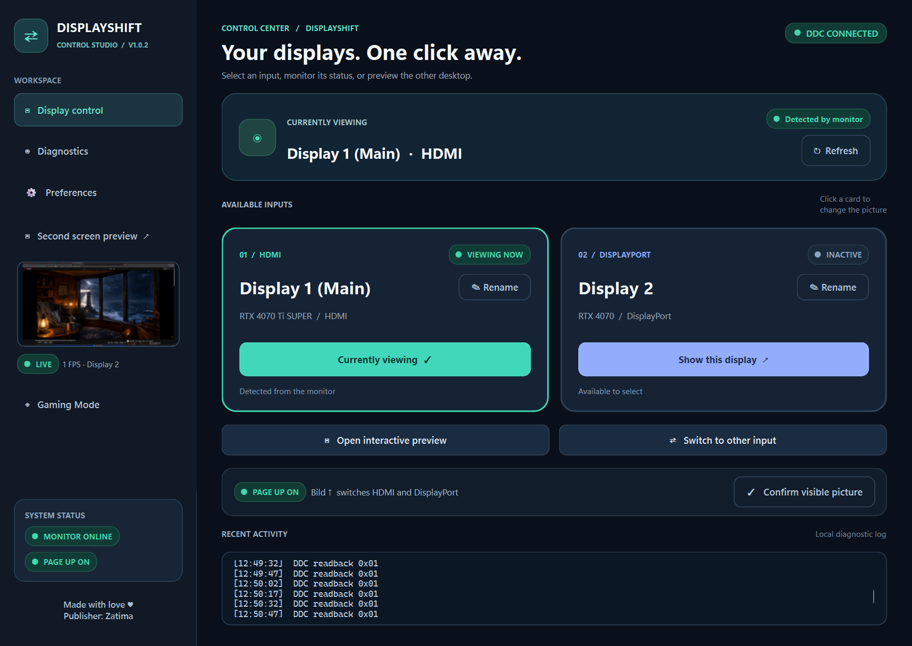
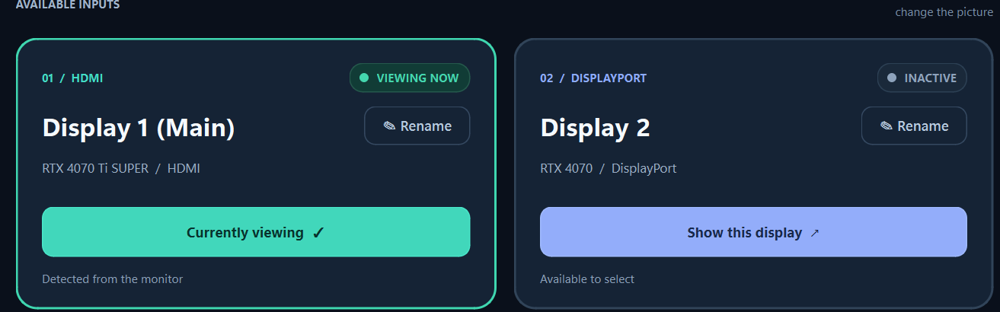

# DisplayShift · Official V1.0.2

*Actual v1.0.2 application screenshot captured on Windows 11.*

**[Download DisplayShift v1.0.2](https://github.com/zatimamo/DisplayShift/releases/tag/v1.0.2)** (link becomes active when published).

**DisplayShift** is a lightweight Windows utility for switching a monitor between two GPU video inputs over DDC/CI. It also provides a small, low-FPS preview of the second Windows desktop and a compact Gaming Mode.

**Publisher:** Zatima  
**Credit:** Made with love ♥ · Publisher: Zatima  
**Version:** Official V1.0.2 (1.0.2)  
**Platforms:** Windows 11 x64 (tested), other Windows 10/11 x64 configurations are not fully validated.

## Download and run

The two official release files are:

| File | Usage |
| --- | --- |
| `DisplayShift_V1.0.2_Setup.exe` | Guided installation, Start-menu entry, optional Desktop shortcut, and uninstaller |
| `DisplayShift_V1.0.2_Portable.zip` | Extract the entire `DisplayShift_Portable` folder and run `DisplayShift.exe`. No installer needed |

The portable and installed editions use `%LOCALAPPDATA%\DisplayShift\settings.json` for user preferences. They share settings when run under the same Windows user account.

## Features

- DDC/CI VCP input switching, where supported by the monitor.
- Global **Page Up / Bild ↑** shortcut for switching inputs without another confirmation.
- Individually named input cards and current input indicators: **green** means detected or visually confirmed; **amber** means a switch was requested; **red** means unavailable or failed; **gray** means inactive/unknown.
- Small sidebar thumbnail preview at **1 FPS**.
- Expanded interactive desktop preview with optional mouse and keyboard relay.
- Gaming Mode with just a 1 FPS preview, display buttons, and Page Up option; regular polling and the normal preview are suspended while active.
- English, French, German, Simplified Chinese and Arabic (right-to-left interface).
- Teal dual-arrow icon and fully visible, two-line publisher footer.

## Important hardware compatibility note

The current input-switching profile was developed and tested on a **Samsung Odyssey G7** with two active Windows outputs: HDMI on an NVIDIA GeForce RTX 4070 Ti SUPER and DisplayPort on a separate NVIDIA GeForce RTX 4070.

This is **not a universal monitor-control solution**. Input switching depends on physical connection enumeration, the monitor's DDC/CI capability, VCP feature 0x60 and the configured input codes. Preview of a Windows desktop also requires it to remain enumerated by Windows. Other hardware may require source changes and separate validation.

The application never promises a completed physical input switch solely from a successful DDC write: confirm the visible picture when needed. Keep your monitor's physical input selector available.

## Security and privacy

The distributed executable contains native-compiled application components and runtime dependencies; no editable Python source is distributed with public releases. This discourages casual modification, but **no offline application is tamper-proof**.

DisplayShift uses local Windows APIs and does not require a cloud service for switching or local preview. The app is **not digitally signed** with a trusted Authenticode certificate. Windows may show a publisher warning on first installation; this is separate from the text publisher metadata **Zatima**.

## Troubleshooting

**Preview shows the wrong screen:** Check that Windows still detects both video outputs and that the monitor connections match the expected hardware profile.

**Page Up does nothing:** Another program may already own the hotkey. Check the Page Up status in DisplayShift and close the conflicting application.

**The screen switched, but the card is amber:** The monitor returned an ambiguous readback. Confirm the actual physical picture before marking the mapping verified.

**The publisher text appears covered:** This was corrected in Official V1 by placing the status card and two-line publisher credit in an independent footer; the navigation area now scrolls separately.

## Closed-source licensing

These GitHub-ready materials are intended for **binary releases**. The editable developer source is stored separately and should **not** be added to a public repository if source protection is desired.

DisplayShift application code is proprietary, closed source, and not released under an open-source license. See LICENSE and THIRD_PARTY_NOTICES.txt. Third-party licenses and statutory user rights continue to apply.

© 2026 Zatima. All rights reserved unless otherwise licensed by the rights holder.

## V1.0.1 startup fix

Fixed the startup exception affecting saved Arabic language. Qt layout change events previously called App.changeEvent before gaming_mode existed. Early initialization and a guarded callback now avoid this crash.

The compiled EXE passed clean starts in all five languages. Both installer and portable builds passed isolated launch tests with Arabic saved.

## V1.0.2 language behavior

The Windows Setup installer selects English on the first start after installation, even if an older installation previously saved Arabic. It preserves display names, DDC input mappings, and other configuration. Later language preferences remain saved.

The portable edition does not reset saved language settings. Fresh users default to English automatically.

## Proprietary distribution

Only compiled binary downloads are public. The source code remains private and is not included in this GitHub repository. Third-party packages such as PySide6/Qt have their own license requirements.
